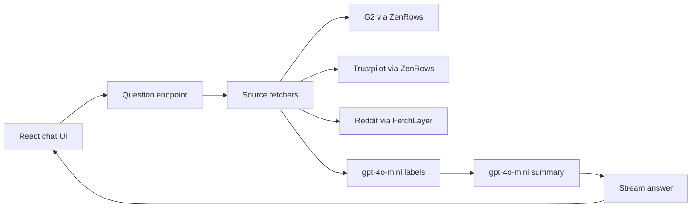

# SignalOne — Miro board blueprint

Use this as the board structure for the first product workshop. Each `##` is a frame and each bullet is a card.

## Frame 1 — Product north star

- **Outcome:** Ticmint can ask a question about a brand and see the customer signal with links back to real reviews.
- **Primary user:** Ticmint team.
- **Brands:** Eventbrite, Ticket Tailor, Townscript, BookMyShow, or any typed brand.
- **Core loop:** Select source → enter brand → ask question → fetch reviews → score reviews → stream answer → open original review.
- **MVP success:** A reviewer can understand the main complaints in under 30 seconds and verify every claim.

## Frame 2 — End-to-end user flow

1. User opens SignalOne.
2. User chooses `All sources`, G2, Reddit, or Trustpilot.
3. User enters a brand.
4. User asks a natural-language question.
5. UI shows `Fetching reviews…`.
6. UI shows `Scoring…`.
7. Answer streams into the chat.
8. User scans sentiment, complaint shares, and review snippets.
9. User opens a numbered original review link.

## Frame 3 — UI anatomy

- **Left sidebar:** SignalOne wordmark, New chat, recent chats, Ticmint workspace.
- **Top bar:** live review index status and help affordance.
- **Empty state:** title, supporting line, three clickable example questions.
- **Chat thread:** user question on the right, SignalOne answer on the left.
- **Answer:** typed summary, sentiment split, top three complaints, review list.
- **Composer:** source dropdown, brand field, question field, send button.
- **Responsive rule:** collapse the sidebar on mobile; keep source, brand, and question controls usable.

## Frame 4 — Answer contract

- **Summary:** two or three lines, generated from the labeled review set.
- **Sentiment:** positive %, neutral %, negative %.
- **Complaints:** fees, payouts, support, UX, refunds, reliability, other.
- **Review row:** source, date, sentiment, complaint tag, snippet, original link.
- **Trust rule:** every summary claim must be traceable to the retrieved reviews.

## Frame 5 — System map

## Frame 6 — States to design and test

- Empty chat.
- Composer focused.
- Send disabled until a question exists.
- Fetching reviews.
- Scoring reviews.
- Streaming summary.
- Completed answer with reviews.
- No reviews found.
- Source fetch error.
- Invalid or blank brand.
- Mobile sidebar collapsed.

## Frame 7 — Technical decisions

- **App:** React.
- **Animation:** Motion (`motion.dev`) for presence, staggered cards, loading transitions, and streamed answer reveal.
- **Editor:** Tiptap for the question composer if rich text, slash commands, or structured prompts are needed later.
- **MVP composer:** start as a Tiptap single-line editor with plain text output; preserve a clean migration path to prompt chips and mentions.
- **Styling:** Inter, white canvas, cool grey sidebar, green `#16A34A`, neutral `#6B7280`, red `#DC2626`.

## Frame 8 — Milestones

### M0 — Foundation and board (complete)

- Local SignalOne project created.
- Static UX prototype committed to Git.
- Source, brand, examples, loading state, and review answer represented.
- Miro board blueprint captured in this file.

### M1 — React shell and design system

- Convert the prototype into a React app with component boundaries.
- Add shared tokens for color, spacing, type, borders, and radii.
- Build `Sidebar`, `Topbar`, `EmptyState`, `ChatThread`, `Composer`, `AnswerCard`, and `ReviewRow`.
- Add responsive layout and keyboard focus behavior.

### M2 — Motion and Tiptap composer

- Add Motion entrance and exit transitions.
- Animate example cards, loading stages, streamed summary, and answer sections.
- Replace the textarea with a Tiptap editor.
- Add Enter-to-send, Shift+Enter newline, and command focus shortcut.
- Respect `prefers-reduced-motion`.

### M3 — Review pipeline integration

- Add the question endpoint and streaming transport.
- Add source adapters for ZenRows and FetchLayer.
- Normalize reviews into one schema.
- Add gpt-4o-mini review labels, complaint tags, rationale, and summary generation.
- Render numbered source links and preserve original URLs.

### M4 — Reliability and verification

- Test each source with Eventbrite, Ticket Tailor, Townscript, and BookMyShow.
- Add no-result, timeout, partial-source, and malformed-review states.
- Add request cancellation and retry behavior.
- Verify every answer link and sentiment count against the labeled set.

### M5 — Vercel release

- Add environment variables for provider keys and model access.
- Configure production and preview environments.
- Push the React app to the SignalOne Git repository.
- Deploy to Vercel and smoke-test the production URL.

## Frame 9 — Build order for the next session

1. Replace the current static artifact with the React component tree.
2. Install `motion` and `@tiptap/react` once package access is available.
3. Port the current visual styling and interactions without changing the layout.
4. Wire the composer to a mocked streaming response.
5. Add the real API boundary after the UI states are stable.
